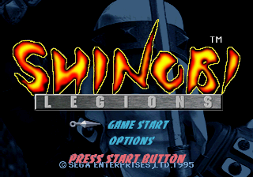
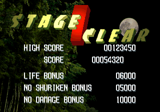

# DIRECTOR.PPB — map for the port

Analysis of the front-end overlay (`extracted/DIRECTOR.dec.bin`, loaded at **0x06040000**,
294 316 bytes → ends at **0x06087DAC**, where its BSS starts). Everything outside the
in-game action lives here: SEGA logo, title, main menu, options (+ hidden sound test),
stage-start movies, story cutscenes, stage-clear tally, continue, game over, ending and staff roll.

Tools used: `SL_OVERLAY=D python3 tools/sh2cap.py D lo hi` (disassembly), `tools/lits.py`.
New tools: `tools/iso_extract.py` (ISO9660 reader without pycdlib), `tools/pbc_decode.py`
(PBC / embedded images → PNG, composes the title and stage-clear screens).
All function names below have been applied in the Ghidra program (DIRECTOR.dec.bin + A.BIN).

Only **~14 KB is code** (0x06040000–0x060435C0); the rest is data: string/movie tables,
the font, the SEGA logo, the continue-screen digits, character lists and palettes for the
.PBC files, and sound area maps.

---

## 1. Entry point and state machines

### 1.1 Overlay protocol (shared with SHINOBI.PPB)

`Boot_And_MainLoop` (A.BIN 0x06004038) calls 0x06040000 once per frame, whatever overlay is
resident. Both overlays dispatch on the same word **`g_DirMode` = 0x06025268** (u16):

| g_DirMode | DIRECTOR (`Director_Entry` 0x06040000) |
|---|---|
| 0 | `Director_Init` 0x06040094 → mode 1 |
| 1 | `Director_RunScene` (inlined; out-of-line copy at 0x0604027A): call `kSceneTable[g_DirScene]` |
| 2 | `Load_ShinobiPPB` (A.BIN 0x06004E6A) then g_DirMode = 0 (out-of-line copy 0x060402CC) |
| 3 | idle |
| 4–7 | g_DirMode++ (unused) |

`Load_ShinobiPPB` / `Load_DirectorPPB` (0x06004E6A / 0x06004EAC) do **not** load immediately:
they push a request into the resource queue (`Res_QueueRequest` 0x060049C4, 8 slots at
0x060189D4, kind 1 = LZ-decompress while loading, destination 0x06040000) that the main loop
processes after the overlay returns. So the overlay that asked for the swap finishes its
frame, sets g_DirMode = 0, and the next frame the new overlay starts in its init state.
SHINOBI goes back to DIRECTOR with its game mode 11 (0x0606BAA4: `Load_DirectorPPB`,
fade state cleared, g_DirMode = 0) after having written **`g_DirScene` = 0x060252CC**.

`Director_Init` 0x06040094: VDP2 setup through the register shadow (`0x06009254` marks the
shadow dirty): clears 3 words at 0x0603B49E.., `Fade_Reset`, clears the sprite list heads
(0x06020D08 +0/+0x4C/+0x98/+0xE4), `0x0602B344(0,0)` / `(0x100,0)`, sprite control
0x0603B46C = SPTYPE 3, mixed palette/RGB sprites (bit 5), and **the 8 sprite colour-calc
ratios = {0, 8, 16, 24, 31, 31, 31, 31}** (0x0603B48A..; sprite field +0x0E selects one:
0 = opaque, 2 = ~50 % — used to dim unselected menu items, 3→0 = fade-in of the game-over
text). Then global sprite zoom 0x060250E0 = 1.0, scene step = 0, `0x06005BB4`
(clear VDP2 TVMD.DISP shadow + resync), g_DirMode++.

### 1.2 Scenes (`g_DirScene` 0x060252CC, u32) — table 0x060435C0

Each scene is a small state machine on **`d_SceneStep` = 0x06087DAC** (u32), with a frame
timer **0x06087DB4** (u16). Display on/off = bit 15 (DISP) of the VDP2 TVMD shadow
**0x0603A570**: every scene sets it when its graphics are ready and clears it before leaving.

| g_DirScene | handler | screen | requested by |
|---|---|---|---|
| 0 | 0x0604059E | SEGA logo, then title | boot (A.BIN 0x06004104), game over, staff roll end, demo end (natural) |
| 1 | 0x06040E76 `Scene1_Title` | title / main menu / options / sound test / attract | logo, soft reset (A.BIN 0x06004370), demo end (aborted) |
| 2 | 0x06042668 | stage start (STGSTRTn.CPK) → launch SHINOBI | new game, continue, story movie |
| 3 | 0x0604059E | same as 0 | (nobody seen) |
| 4 | 0x060407F2 | story movie (TOUJYOU / DEMO_n / ENDING) | STGCLEAR, SHINOBI after 9-1, stage start of a new game |
| 5 | 0x06042D18 `Scene5_ContinueGameOver` | continue countdown / game over | SHINOBI game over (mode 9) |
| 6 | 0x06042D18 | same as 5 | (nobody seen) |
| 7 | 0x060432C4 | staff roll | story movie after the ending |
| 8 | 0x06042840 | stage clear tally (STGCLEAR.PBC) | SHINOBI tally (mode 7) |

#### Scene 0 / 3 — SEGA logo (0x0604059E)
| step | addr | what |
|---|---|---|
| 0 | `Logo_Step0_Init` 0x060405F6 | DISP off, 0x060252E0 = 1, `CheatSeq_Reset`, 0x06087DB6 = 0 |
| 1 | `Logo_Step1_Load` 0x06040640 | **if 0x06014404 == 0 (first boot): set it to 1 and skip to step 3** (the BIOS already showed SEGA). Else fade offsets = +256 (white), `Fade_SetupDuration(64,1,1)`, `Fade_StartIn`, `Snd_StopAll`, `Lz_Decompress(0x0608466A → VDP1 0x25C04740)`, `Char_RegisterList(0, 0, 0x060870B0)` (one 320×224 RGB char), DISP on |
| 2 | `Logo_Step2_Show` 0x060406F4 | draw char 0 at (0,0); timer++; at 240 fade out to black (speed 0x80000); when fade idle → step 3 |
| 3 | `Logo_Step3_End` 0x0604077C | fade offsets 0, 0x060252E0 = 1 |
| 4 | inline 0x060405C4 | g_DirScene = 1, step 0 |

#### Scene 1 — Title (0x06040E76, `braf` table 0x06040F14, 18 entries)
| step | addr | what |
|---|---|---|
| 0 | 0x06040F3E | **new-game defaults** (see §4.2), menu vars cleared, 0x060252E0 = 1 |
| 1 | 0x0604102C | `Res_Request(1, 1, 0, -1, 0x25C04740, "TITLE.PBC")` (sync, LZ) ; 0x060DCF94 = 1 ("press start" phase) |
| 2 | 0x06040E86 | wait one frame |
| 3 | 0x06041078 | `Char_RegisterList(0,0,0x06087230)`, `Pal_Copy(0, 64, 0x060871B0)`, `Snd_SetAreaMap(0x060443EE)`, `CheatSeq_Reset`, `Res_Request(2,0,0,-1,0,"TITLE.PCM")` (= CD-DA track 2, see §3.2), `Snd_SetCdDaLevel(6,6)`, `Snd_SetCdDaPan(31,15)`, `0x06030710(15)`, demo counter 0x06014408 &= 0xFF, DISP on, fade in from white (16 frames) |
| 4 | 0x06041184 | **title loop**: `Title_DrawBg` 0x06041428 (char 0), `CheatSeq_Record`. While 0x060DCF94 = 1: blinking "PRESS START BUTTON" (char 6 at 85,164, colour bank 3, visible when frame counter 0x060143EA & 0x10); Start (if not fading in) → 0x060DCF94 = 0, `Snd_Play(0x108)`, 0x060252E0 = 0. Then `Title_MenuUpdate` 0x06041458. Idle timer 0x060DCF92: at **2280 frames (38 s)** with no menu choice → fade to black (0x40000/frame) + CD-DA fade (`Music_FadeStep` 0x06041702: level 0x060DCF9E 6→0, one step every 5 frames) → step 5 |
| 5 | 0x060412D4 | **launch**: fade offsets 0, `Res_CloseIfOpen`, HP max / lives / continues from difficulty. If no menu choice → **attract demo**: g_DirMode++ (load SHINOBI), `Res_Request(1,0,0,-1,0x00200000,"SHOU.CHR")`, 0x060252DC = 1, stage = demo counter & 0xFF, counter += 2 (wraps after 8 → demos on stages index 0,2,4,6,8 = 1-1..5-1), counter \|= 0x8000 (demo flag). If OPTIONS → step 6. If GAME START → g_DirScene = 2, stage 0, cheats (§5.3) |
| 6 | `Options_Init` 0x06041744 | `Font_Init(0x200, 64, 0x58800)`, fade in from white, `Res_Request(1, 2, 0,-1, 0, *(0x06087180))` = STAGE7.SND bank, menu vars = 0, DISP on |
| 7 | `Options_Update` 0x06041804 | draw (`Options_DrawBg` 0x06041958, `Options_DrawItems` 0x060419C4, `Options_DrawCursor` 0x06041C50), `Options_Input` 0x06041C8E. Exit: Start, or C on EXIT → fade out, step 8. If the invincibility cheat is active and RT held + Start → step 16 (sound test) |
| 8 | `Options_WaitFadeOut` 0x060418B8 | draw until fade idle |
| 9 | `Options_Exit` 0x060418E4 | fade from white, `Snd_StopAll`, `Res_CloseIfOpen`, DISP off, **step = 3** (re-register the title chars; TITLE.PBC is still in VRAM) |
| 10–15 | — | nothing |
| 16 | 0x06040ED8 | 0x060872F0 = 0, `Res_CloseIfOpen`, step 17 |
| 17 | `SoundTest_Update` 0x0604232A | debug sound test (§5.4) |

Main menu `Title_MenuUpdate` 0x06041458: **0x060DCF8E** = bit 0 cursor (0 GAME START,
1 OPTIONS), bit 7 confirmed. Up/Down (pressed & 0x3000) toggles + `Snd_Play(0x10C)`;
Start confirms + `Snd_Play(0x108)`. `Title_DrawCursor` 0x060415A8: char 2 (shuriken) at
x = 88 + bob[0x060DCF90 % 24] (table 0x0604387A, ±4 px), y = 152 / 172.
`Title_DrawMenuItems` 0x06041620: char 3 (GAME START) at (136,152), char 4 (OPTIONS) at
(136,172), colour bank 1, colour-calc 2 when not selected; the chosen one blinks
(timer & 8). 64 frames after confirming: fade to black + CD-DA fade, then step 5.

#### Scene 2 — Stage start (0x06042668)
| step | addr | what |
|---|---|---|
| 0 | `StgStart_Step0_InitBonus` 0x06042692 | fade offsets 0; **bonus seeds** LIFE 0x060252D0 = 0, NO SHURIKEN 0x060252D4 = 5000, NO DAMAGE 0x060252D8 = 1 |
| 1 | `StgStart_Step1_StartMovie` 0x060426E4 | `Movie_SetPlaylist({0x06043D40[stage>>1], -1}, 0x100, 0x58800, 3)` → STGSTRT1..9.CPK (movie ids 17..25), not skippable |
| 2 | `StgStart_Step2_PlayMovie` 0x06042734 | `Movie_Update`; after the end, hold the last frame (`Movie_DrawFrame`) up to 120 frames (Start skips); fade to black (0x100000/frame) |
| 3 | `StgStart_Step3_LaunchStage` 0x060427F0 | `Movie_Stop`, DISP off. **If stage == 0 and 0x060252DC == 0 (fresh game) → g_DirScene = 4 (TOUJYOU intro); else g_DirMode++ → SHINOBI.PPB** |

#### Scene 4 — Story movie (0x060407F2)
| step | addr | what |
|---|---|---|
| 0 | `Story_Step0_PreloadShou` 0x06040824 | if stage == 0: `Res_Request(1,0,0,-1,0x00200000,"SHOU.CHR")` |
| 1 | `Story_Step1_StartMovie` 0x06040850 | k = stage>>1; stage 17 → k = 9; stage −1 → k = 10. `Movie_SetPlaylist(0x0604361E + 8k, 0x100, 0x58800, flags)` with flags 1 (stage 0), 2 (ending: not skippable), else 0 |
| 2 | `Story_Step2_PlayMovie` 0x060408C4 | `Movie_Update`; when done: DISP off; stage 17 or 0 → g_DirMode++ (SHINOBI); stage −1 → g_DirScene = 7 (staff roll); else → g_DirScene = 2 (stage start movie) |

Story table 0x0604361E (8 bytes/entry = 4 × s16 playlist): k0 TOUJYOU (12), k1–k6 DEMO_1..6,
k7 DEMO_8, k8 DEMO_9, k9 DEMO_10, k10 ENDING (11).

#### Scene 5 / 6 — Continue and game over (0x06042D18, `braf` table 0x06042D94, 20 entries)
| step | addr | what |
|---|---|---|
| 0 | 0x06042DC2 | fade 0; `Font_Init(0x200, 64, 0x8000)`; `Lz_Decompress(0x0608742C → VDP1)` (digits 0–9 + "CREDIT-", list 0x060873D0, palette 0x060873B0); if continues 0x060252C2 == 0 → step 16 |
| 1 | 0x06042E58 | `Res_Request(1,0,0,-1,0x00200000,"CONTINUE.CPK")` (preload to LWRAM), playlist {13 = CNTCOUNT.CPK, −1} flags 3 |
| 2 | 0x06042EB0 | countdown movie + `Continue_DrawCredits` 0x0604302E ("CREDIT-" at 176,16 and digit = continues at 288,16). **Start between frames 50 and 520 → continue** (`Movie_Stop`, continues−−, step 3); movie end → step 18 (game over text) |
| 3 | 0x06042F40 | playlist {0x100E, −1}: id ≥ 0x1000 = play **from memory** (LWRAM copy of CONTINUE.CPK) |
| 4 | 0x06042F64 | play; when done reload `SHOU.CHR` into LWRAM (the movie overwrote it) |
| 5 | 0x06042FE4 | **continue**: shurikens = initial, lives = table[difficulty], magic 0, 0x060252B2 = 0, **stage &= ~1 (back to act 1)**, stage state 0, g_DirScene = 2. Score is kept |
| 16 | 0x06042D46 | playlist {16 = GAMEOVER.CPK, −1} flags 3 |
| 17 | `GameOver_PlayMovie` 0x060430F2 | play, keep last frame |
| 18 | `GameOver_ShowScore` 0x06043140 | last frame + "HIGH SCORE" (80,160)/(184,160) and "SCORE" (120,184)/(184,184), colour-calc 3→0 over 32 frames; Start skips; at 600 frames fade out |
| 19 | `GameOver_Exit` 0x0604327E | DISP off, g_DirScene = 0 |

#### Scene 7 — Staff roll (0x060432C4)
| step | addr | what |
|---|---|---|
| 0 | `StaffRoll_Init` 0x060432F4 | `Res_Request(1,1,0,-1,0x25C04740,"STAFFROL.PBC")`, `Char_RegisterList(0,0,0x06087BB0)` (63 chars), `Pal_Copy(0,16,0x06087B90)`, `Res_Request(2,0,0,-1,0,"ENDING.PCM")` (CD-DA track 3), CD-DA level 6, scroll 0x060DD028 = 0 |
| 1 | `StaffRoll_Scroll` 0x060433CC | `StaffRoll_Draw`; scroll += 0x8000 (0.5 px/frame) until the end marker is on screen |
| 2 | `StaffRoll_Hold` 0x0604340C | 900 frames (Start after 120 skips), fade out |
| 3 | `StaffRoll_Exit` 0x060434B0 | g_DirScene = 0 |

`StaffRoll_Draw` 0x060434DC: script 0x06043E00, 8-byte entries {u16 char, u16 x, u16 dy, 0};
y += dy (px), drawn at y − scroll; char 0x1000 = end marker (sets 0x060DD02C when
y < scroll + 224), char < 0 = end of list.

#### Scene 8 — Stage clear (0x06042840)
| step | addr | what |
|---|---|---|
| 0 | `StgClear_Init` 0x0604288C | `Font_Init(0x200,64,0x58800)`, `Res_Request(1,1,0,-1,0x25C04740,"STGCLEAR.PBC")`, `Char_RegisterList(0,0,0x06087354)`, `Pal_Copy(0,32,0x06087314)`, fade from white, `Snd_StopAll`, `Snd_Play(1)` (stage clear tune) |
| 1 | `StgClear_Tally` 0x0604295C | draw; after 160 frames move 100 points per frame from each non-zero bonus into the score (`Score_Add`); when all are 0, A/B/C/Start (0x0F00) jumps to 480; > 480 → fade out |
| 2 | `StgClear_Exit` 0x06042A44 | when the fade ends: DISP off, **g_DirScene = 4** (story movie for the next stage) |

`StgClear_DrawBg` 0x06042AA8: char 10 (320×224 RGB bg) at (0,0), stage digit char
(stage>>1)−1 (stage −1 → 8) at (128,8) colour bank 1, "STAGE CLEAR" banner char 9 at (16,24).
`StgClear_DrawText` 0x06042B5C: font, 8 digits with leading zeros for the scores,
5 digits for bonuses: HIGH SCORE (48,88)/(208,88) = *0x06000214; SCORE (88,112)/(184,112)
= 0x060252C8; LIFE BONUS (48,144)/(232,144) = 0x060252D0; NO SHURIKEN BONUS (48,168)/(232,168)
= 0x060252D4; NO DAMAGE BONUS (48,192)/(232,192) = 0x060252D8.
`Score_Add` 0x06042C98: score += n (max 99 999 990), updates the hi-score 0x06000214,
extra life when score/threshold increases (threshold = 0x06014418[difficulty], u32) →
`Lives_Add(1)` 0x06042C6C (clamp 0..99) + `Snd_Play(0x107)`.
Bonus values are computed by SHINOBI before the hand-off (0x0606BA08): LIFE = HP × 1000;
NO DAMAGE = 10 000 if HP ≥ HP max (else 0); NO SHURIKEN = 5000 unless SHINOBI cleared it.

### 1.3 Full flow

```
boot (A.BIN): stage=-1, difficulty=NORMAL(1), control=0, shurikens=20, g_DirScene=0
 └─ scene 0 (logo; skipped on first boot) ─► scene 1 title
      ├─ idle 38 s ─► attract demo: SHINOBI stage 0/2/4/6/8 (demo flag 0x06014408|0x8000)
      │                 └─ demo end (SHINOBI 0x0606BB8A: 1800 frames, or Start → 0x06014408 |= 0x4000):
      │                    request 0 = timed out (→ SEGA logo → title), 1 = Start pressed (→ title)
      ├─ OPTIONS ─► options ─► back to title (step 3)   [RT+Start with cheat ─► sound test]
      └─ GAME START ─► scene 2 (STGSTRT1) ─► scene 4 (TOUJYOU) ─► SHINOBI stage 0 (1-1)
SHINOBI:
  act 1 cleared (even stage) ─► SHINOBI reloads the next act itself (game mode 5)
  act 2 cleared (odd stage)  ─► stage++ (17 → -1), tally mode 7 ─► request 8
       ─► scene 8 STGCLEAR ─► scene 4 DEMO_n ─► scene 2 STGSTRT(n+1) ─► SHINOBI
  9-1 cleared (stage 16→17)  ─► request 4 ─► scene 4 DEMO_10 ─► SHINOBI 9-2 (no STGSTRT)
  9-2 cleared (stage → -1)   ─► request 8 ─► STGCLEAR ─► scene 4 ENDING.CPK ─► scene 7 staff roll ─► scene 0
  death, lives < 0           ─► game mode 9 ─► request 5 ─► continue (─► scene 2) or game over (─► scene 0)
soft reset A+B+C+Start (A.BIN Sys_CheckSoftReset 0x060042B8), action from 0x060252E0:
  1 = return to the BIOS (title/logo screens), 0 = reload DIRECTOR into scene 1, -1 = ignored
```

---

## 2. Graphics

### 2.1 Everything is VDP1

DIRECTOR never uses VDP2 backgrounds: full-screen pictures are **320×224 RGB555 VDP1
sprites** (colour mode 0x28) and text/menu items are **4bpp colour-bank sprites** (mode 0).
All are drawn every frame through the normal sprite path (`Sprite_Draw` 0x060068C0 with the
sprite struct at **0x060250AC**: +0 char, +2/+4 x/y, +0x0A colour bank (16-colour units),
+0x0E colour-calc ratio index, +0x10 flags) — the same path the pc-port already emulates.

### 2.2 .PBC format

* The whole file is **one block of the word-LZ** used everywhere (`tools/ppb_decompress.py`;
  `Lz_Decompress` A.BIN 0x06004EE8; header u32 = 0x80000000 | size in words).
* **No header after decompression**: raw VDP1 character data, characters concatenated.
* Loaded with `Res_Request(1, kind 1, …, 0x25C04740, name)`: kind 1 decompresses while
  reading (A.BIN 0x06004AA0), straight into VDP1 VRAM at the character area 0x25C04740.
* Dimensions, colour mode and palette are **not in the file** but in DIRECTOR:
  character list registered by **`Char_RegisterList(baseId, vramOffset, list)`** (A.BIN 0x06006E64):
  `u16 0, u16 count` then `count × { u16 offset/32, u16 size/32, u16 mode, u8 width/8, u8 height }`
  → `Char_Register(baseId+i, w, h, mode, vramOffset)` (A.BIN 0x06006DE4), vramOffset += size.
* Palettes: RGB555 (R bits 0–4, G 5–9, B 10–14), copied with `Pal_Copy(dst, n, src)`
  (A.BIN 0x06005C30) into the shadow CRAM 0x06024098; index 0 of each 16-colour bank is
  transparent; RGB pixels need bit 15 set to be opaque.

| file | decompressed | list | palette | contents |
|---|---|---|---|---|
| TITLE.PBC | 0x46BA0 | 0x06087230 (7) | 0x060871B0, 64 → CRAM 0 | 0: title bg RGB 320×224 · 1: options bg RGB 320×224 · 2: shuriken cursor 40×10 · 3: GAME START 80×12 · 4: OPTIONS 64×12 · 5: OPTIONS title 112×16 · 6: PRESS START BUTTON 152×13 |
| STGCLEAR.PBC | 0x2B860 | 0x06087354 (11) | 0x06087314, 32 → CRAM 0 | 0–8: stage digits 1–9 (64×88, 72×88), 9: "STAGE CLEAR" banner 288×64, 10: bg RGB 320×224 |
| STAFFROL.PBC | 0x3C500 | 0x06087BB0 (63) | 0x06087B90, 16 → CRAM 0 | 62 credit lines 320×24 + one 320×56 |
| *(DIRECTOR)* 0x0608466A | 0x23000 | 0x060870B0 (1) | — | SEGA logo RGB 320×224 (LZ block is one word short of the char) |
| *(DIRECTOR)* 0x06043F9C | 0x9C0 | 0x06044272 (39) | 0x060443AE, 32 | font 8×16, 4bpp |
| *(DIRECTOR)* 0x0608742C | 0x880 | 0x060873D0 (11) | 0x060873B0, 16 | continue digits 0–9 16×16 + "CREDIT-" 112×16 |

The other .PBC files on the disc (BIRD, BISYAMON, DRAGON, HANNYA2, KAZUMA2, KM99, KORYU1/2,
MANU2/3, NYORAI, SAKYOU, UKYOU2/3, ZIRYU) are **not referenced by DIRECTOR**: they are boss
graphics loaded by SHINOBI (same LZ format; their lists are in SHINOBI).

Check: `python3 tools/pbc_decode.py title docs/screenshots/director_title.png` and
`… stgclear docs/screenshots/director_stgclear.png` rebuild the screens exactly as the code
draws them (`… sheet NAME out.png` dumps every char).

 

### 2.3 Font and text

* `Font_Init(charBase, colourBank, vramOffset)` 0x06040318: stores 0x06087DB0 / 0x06087DB2,
  decompresses the font to 0x25C04740 + vramOffset, registers 39 chars from `charBase`
  (always 0x200), copies 32 colours to CRAM colourBank×16 (always bank 64 = colour 1024).
* `Font_DrawChar(c, bank, x, y)` 0x06040368: '0'–'9' → 0–9, 'A'–'Z' → 10–35, '.' 36,
  ':' 37, '-' 38, ' ' = nothing (no lowercase). Sprite char = charBase + glyph,
  colour bank = font bank + `bank`; +0x0E (dimming) is set by the caller.
* `Font_DrawString(str, bank, x, y)` 0x060403FA: advance 8 px.
* `Font_DrawNumber(value, bank, x, y, [stack] digits, [stack] flags)` 0x0604042E: decimal,
  flags bit 0 = blank leading zeros. `Font_DrawHex` 0x060404E8: same in hex (sound test).
* Strings: all in DIRECTOR data 0x060438AC–0x06043DF4 (menu labels, sound test, option
  values, stage-clear labels). Pointer tables: difficulty 0x0608726C (EASY/NORMAL/HARD),
  button actions 0x06087278 (SHURIKEN/KATANA/JUMP), music names 0x06087284 (24 entries),
  audio 0x060872E4 (STEREO/MONO), .SND files 0x06087180, CD-DA files 0x060871A8.

---

## 3. Movies and audio

### 3.1 CPK = Sega FILM / Cinepak (SBL CPK library in A.BIN)

The ".CPK" files are Sega FILM containers (`FILM`, `FDSC` "cvid" 320×224 or 320×176,
`STAB` sample table) with Cinepak video and 16-bit big-endian mono PCM (22 050–22 255 Hz).
ffmpeg reads them (`film_cpk` demuxer). The code is Sega's **CPK library** linked in A.BIN
— the "streaming engine" previously documented at 0x0600A000–0x0600E200
(`Stream_InitFromHeader` parses the FILM header: STAB at +0x30, entry count at +0x3C,
16-byte entries) is that library.

DIRECTOR wrapper (all renamed in Ghidra):

| function | addr | role |
|---|---|---|
| `Movie_SetPlaylist(list, charId, vramOff, flags)` | 0x06040944 | copies a −1-terminated s16 list of movie ids (≤ 25) to 0x060DCF48; 0x060DCF7E = 0x100 (char id of the frame), 0x060DCF80 = 0x58800 (VDP1 VRAM offset of the frame), flags 0x060DCF88 (bit 1 = Start cannot skip); state 0x060DCF84 = 0, index 0x060DCF7C = 0 |
| `Movie_Update` | 0x0604097A | state 0: VDP2 setup; 1: open (id < 0x1000 → `Movie_GfsInit` + `Movie_OpenFile(0x060870BC[id])`, else `Movie_OpenMem(0x00200000, 1 MB)`), DISP on; 2: `Movie_Tick`, next id or state −1 when the list ends |
| `Movie_Tick` | 0x06040BDC | `Cpk_TaskFrame` (A.BIN 0x06008CF4); playing → Start skips (unless flags bit 1) else `Movie_DrawFrame`; returns −1 end, −2 skipped |
| `Movie_DrawFrame` | 0x06040CC4 | one sprite, char *0x0602525C, centred: x = (320 − w)/2, y = (224 − h)/2 (w/h at 0x06025254/58) |
| `Movie_OpenFile` / `Movie_OpenMem` | 0x06040B10 / 0x06040B9C | `Cpk_OpenMovie` (A.BIN 0x06008DBE) with work 0x06087DB8 (0x5184 B), ring buffer 0x0608CF3C (0x50000 B), PCM buffer in sound RAM 0x25A60000 (64 KB) |
| `Movie_Close` / `Movie_Stop` | 0x06040C5E / 0x06040AD6 | `Cpk_DestroyGfsMovie` 0x06009F76 or `Cpk_DestroyMemMovie` 0x060097C4, `Cpk_End` |
| `Movie_GfsInit/OpenByName/Close` | 0x06040D0C / 0x06040D5C / 0x06040DCC | GFS file system calls |

Movie id table 0x060870BC: 0 OPENING, 1–10 DEMO_1..10, 11 ENDING, 12 TOUJYOU, 13 CNTCOUNT,
14 CONTINUE, 15 TITLE, 16 GAMEOVER, 17–25 STGSTRT1..9.

| file | size | duration | used by |
|---|---|---|---|
| STGSTRT1–9 | 320×224 | ~4.8 s | scene 2 (stage start, not skippable) |
| TOUJYOU | 320×224 | 8.2 s | scene 4 before 1-1 |
| DEMO_1..6, 8, 9, 10 | 320×176 | 59–206 s | scene 4 between stages (skippable) |
| ENDING | 320×176 | 185 s | scene 4 after 9-2 (not skippable) |
| CNTCOUNT | 320×224 | 31.6 s | continue countdown |
| CONTINUE | 320×224 | 1.9 s | continue accepted (played from LWRAM) |
| GAMEOVER | 320×224 | 7.4 s | game over |
| OPENING (158 s), TITLE.CPK (4.6 s), DEMO_7 (77 s) | | | **no reference found**; unreferenced playlists {0,−1} 0x06043838 and {15,−1} 0x0604383C sit next to "TITLE.PBC" — leftovers (check in an emulator) |

### 3.2 TITLE.PCM / ENDING.PCM are CD-DA tracks

Their ISO directory entries point at the **audio tracks**: TITLE.PCM LBA 188359 = track 2
(41:49:34 + 2 s pregap), ENDING.PCM LBA 191141 = track 3 (42:28:41), so they are absent
from `extracted/track1.iso`. `Res_Request(2, …)` only opens the file; the music plays as
CD-DA (`Snd_SetCdDaLevel(l, r)` 0x0603125C 0–7, `Snd_SetCdDaPan` 0x060312F4). Track 2 ≈ 37 s
(title loop), track 3 ≈ 99 s (staff roll). Port: rip tracks 2/3 from the .bin (raw 2352-byte
sectors, 44.1 kHz 16-bit stereo LE) to WAV/OGG.

### 3.3 SCSP sound

* `.SND` banks (STAGE1..9.SND, KAZUMA.SND; SBL sound area map + data) are loaded by
  `Res_Request(1, kind 2, …)` into sound RAM. Bank index = 0x06087180 table order
  (0 STAGE7 … 5 STAGE6, 6 STAGE1, 7 STAGE8, 8 STAGE9, 9 KAZUMA); current bank 0x060DCF9C.
* `Snd_SetAreaMap(map)` 0x06007E96: built-in maps 0x060443EE (title/menus) and 0x06087124
  (movies: frees sound RAM for the CPK PCM buffer). `Snd_StopAll` 0x06007E00.
* `Snd_Play(id)` 0x06007CDE: SE ids used here: 0x107 extra life, 0x108 confirm,
  0x10C cursor; sequences: 1 = stage clear. Music test table 0x0604391C
  (16 B: {type, seq, bank, 0}; type 1 = CD-DA track (bank 0 TITLE, 1 ENDING)):
  0 TITLE (CD-DA), 1 STAGE START (seq 0), 2 STAGE CLEAR (1), 3 DEATH (2),
  then per stage s: seq 3 = act 1, seq 4 = act 2 in bank s−1, 2-3 = seq 5 bank 1,
  9-1/9-2 = seq 3 banks 7/8.
* AUDIO option: 0x06025246 (0 stereo / 1 mono), also writes the driver mono flag at
  *(0x0603BBB8)+3 (0 / 0x80).

---

## 4. Starting a stage

### 4.1 Stage index ↔ files

`g_StageIdx` 0x0602526A (s16), 0..17, pairs = (act 1, act 2) of a game stage; −1 = game
finished. Verified in DIRECTOR (story/STGSTRT tables use stage>>1, music test table uses
bank stage>>1) and SHINOBI (name tables 0x060CEEE4 / 0x060DAF74):

| idx | 0 1 | 2 3 | 4 5 | 6 7 | 8 9 | 10 11 | 12 13 | 14 15 | 16 17 |
|---|---|---|---|---|---|---|---|---|---|
| game stage | 1-1 1-2 | 2-1 2-2 | 3-1 3-2 | 4-1 4-2 | 5-1 5-2 | 6-1 6-2 | 7-1 7-2 | 8-1 8-2 | 9-1 9-2 |
| files | STAGE7_x | STAGE2_x | STAGE3_x | STAGE4_x | STAGE5_x | STAGE6_x | STAGE1_x | STAGE8_x | STAGE9_x |
| sound bank | STAGE7.SND | STAGE2.SND | … | | | | STAGE1.SND | STAGE8.SND | STAGE9.SND |
| movie before | STGSTRT1 (+TOUJYOU) | DEMO_1 + STGSTRT2 | DEMO_2 + STGSTRT3 | DEMO_3 + 4 | DEMO_4 + 5 | DEMO_5 + 6 | DEMO_6 + 7 | DEMO_8 + 8 | DEMO_9 + 9 / DEMO_10 before 9-2 |

(So "1-1" of the game is file STAGE7_1, index 0; the old note "index 12 = 1-1" refers to the
file name STAGE1_1, which is game stage 7-1.)

### 4.2 Variables written by DIRECTOR

| addr | name | new game (title step 0 + 5) | continue (scene 5 step 5) | next stage |
|---|---|---|---|---|
| 0x0602526A | stage index | 0 | &= ~1 | (SHINOBI ++) |
| 0x060252C4 | difficulty 0–2 | option (boot: 1) | – | – |
| 0x060252C0 | control type 0–5 | option (boot: 0) | – | – |
| 0x060252B0 | HP max | {8,6,4}[diff] (0x06014424) | – | – |
| 0x060252B8 | lives | {6,4,2}[diff] (0x0601442A) | {6,4,2}[diff] | – |
| 0x060252C2 | continues | {7,5,3}[diff] (0x06014430) | −1 | – |
| 0x060252B4 / B6 | initial / current shurikens | B6 = B4 (option 0–100, boot 20) | B6 = B4 | – |
| 0x060252B2 | shuriken pickup counter | 0 | 0 | – |
| 0x060252BA / BE | magic state / magic available | 0 / 0 | – / 0 | – |
| 0x060252C8 | score (u32) | 0 | kept | – |
| 0x060252DC | "not first entry" (Sho drops in when 0) | 0 (demo: 1) | – | – |
| 0x0602529C | cheat flags | 0 | – | – |
| 0x0602529E | stage state | 0 | 0 | – |
| 0x060252D0/D4/D8 | bonuses | 0 / 5000 / 1 (scene 2 step 0, every stage start) | same | same |
| 0x06014408 | demo counter/flags | &0xFF; demo: idx in low byte, 0x8000 demo | – | – |
| 0x060252E0 | soft-reset action | 1 → 0 at Start | | |
| 0x06000214 | hi-score (kept across soft reset; valid if 0x06000210 == "9010") | | | |

Then **g_DirMode++ → `Load_ShinobiPPB`**; the PC equivalent is "switch overlay, run
SHINOBI's init (its mode 0 → game mode 5 = load stage)". SHOU.CHR must be in LWRAM
0x00200000 (loaded by title step 5 for the demo, scene 4 step 0 for a new game, continue
step 4) — SHINOBI also reloads it, the copies only avoid a CD seek.

---

## 5. Input

### 5.1 Pad
Only player 1, via the A.BIN tables (`Pad_Update` 0x0600572A): **0x0601C4A0 +0 held,
+4 pressed (edge)**. Bits: R 0x8000, L 0x4000, Down 0x2000, Up 0x1000, Start 0x0800,
A 0x0400, C 0x0200, B 0x0100, RT 0x0080, X 0x40, Y 0x20, Z 0x10, LT 0x08.
`Pad_GetDirRepeat` 0x06042018: returns Up/Down/Left/Right on press, or while held after
20 frames every 4 frames (frame counter 0x060143EA & 3), counter 0x060DCF8C.

### 5.2 Mapping
| screen | buttons |
|---|---|
| title | Start = press start / confirm; Up/Down = GAME START ↔ OPTIONS |
| options | Up/Down (repeat) = item (7 items, wraps); Left/Right = change value; C = play music/SE, or leave on EXIT; A or B = stop sound; Start = leave |
| movies | Start skips (story movies, TOUJYOU); STGSTRT / continue / game over / ending can't be skipped (the held last frame of STGSTRT can) |
| stage clear | A/B/C/Start after the tally |
| continue | Start (frames 50–520 of the countdown) |
| game over / staff roll | Start skips (staff roll: after 120 frames) |
| anywhere | A+B+C held + Start = soft reset |

Options items (cursor 0x060DCF8E, rows y = 56,72,88,136,152,168,184 from 0x060438FA):
LEVEL (difficulty, wraps 0–2), SHURIKENS (0..100 step 10, wraps), CONTROL TYPE (0–5 →
button layout table 0x0600F290, displayed as A:/B:/C: = SHURIKEN/KATANA/JUMP), MUSIC
(0x060DCF98, 0–23), S.E. (0x060DCF9A, 0–39, plays 0x100+n), AUDIO (stereo/mono), EXIT.

### 5.3 Cheats (`CheatSeq_*` 0x0604223C reset / 0x0604225E record / 0x060422B6 match)
Up to 64 presses (pressed & 0xFF70, i.e. not LT/RT) are recorded at 0x060DCFA8 (count
0x060DCFA4); a sequence matches when the buffer equals it exactly (sequences end with 0).
* Title, then GAME START: **Start A B C B A Start** (0x0604384A) → HP max 1, lives 0,
  continues 0; **Start A Z B Y C X Start** (0x0604385C) → lives 99, continues 9.
* Options, cursor on SHURIKENS, recorded only while LT+RT are held: **C A B** (0x06043908) → 999 shurikens.
* Options, cursor on AUDIO with MUSIC = 8 and S.E. = 6, LT held (not RT): A×10 X B×3 Y C×6 Z
  X×10 A Y×3 B Z×6 C (0x060437E0) → toggles 0x06014414 = 0x4465268F (invincibility, checked by
  SHINOBI with 0x0602529C bit 0) + `Snd_Play(0x108)`.
* With that flag set: options + RT held + Start → **sound test**.

### 5.4 Sound test (debug)
`SoundTest_Update` 0x0604232A: rows SOUND FILE NAME (0x060872F0, .SND list), BANK
(0x060872EC), SEQ (0x060872EE), DRV-ERR / 68K-ERR in hex; C/B start/stop a sequence
(SBL `0x06030B24` / `0x06030A82`), pause through `0x06007DBA`. Low priority for the port.

---

## 6. RAM map (DIRECTOR-owned)

| addr | type | meaning |
|---|---|---|
| 0x06025268 | u16 | g_DirMode (shared with SHINOBI) |
| 0x060252CC | u32 | g_DirScene / request from SHINOBI |
| 0x06087DAC | u32 | scene step |
| 0x06087DB0 / B2 | u16 | font char base / font colour bank |
| 0x06087DB4 | u16 | scene timer |
| 0x06087DB8–0x0608CF3B | | CPK work area |
| 0x0608CF3C–0x060DCF3B | | CPK ring buffer (320 KB) |
| 0x060DCF3C / 40 / 44 | u32 | GFS dir handle / CPK handle / GFS file id |
| 0x060DCF48 | s16[25] | movie playlist |
| 0x060DCF7C / 7E / 80 / 84 / 88 | | playlist index / frame char / frame VRAM offset / movie state (−1 idle, 0 setup, 1 open, 2 play) / movie flags |
| 0x060DCF8C | u16 | pad repeat counter |
| 0x060DCF8E | u16 | menu cursor (+0x80 = confirmed on the title) |
| 0x060DCF90 / 92 / 94 | | cursor bob timer / title idle timer / "press start" phase |
| 0x060DCF98 / 9A / 9C | u16 | options MUSIC / S.E. / loaded .SND bank |
| 0x060DCF9E / A0 | u16 | CD-DA fade level / sub-timer |
| 0x060DCFA4 / A8 | | cheat count / cheat buffer (64 × u16) |
| 0x060DD028 / 2C | u32 | staff roll scroll (16.16) / end reached |
| 0x060872EC / EE / F0 | u16 | sound test bank / seq / file |
| 0x06014404 | u32 | logo already skipped once |
| 0x06014408 | u32 | demo counter (low byte = next demo stage) + 0x8000 demo running, 0x4000 demo aborted |
| 0x06014414 | u32 | 0x4465268F = invincibility cheat |
| 0x0603A570 | u16 | VDP2 TVMD shadow (bit 15 DISP) |

### A.BIN helpers used by DIRECTOR
`Res_Request(type, kind, ?, -1, dest, name)` 0x06004A1C (type 1 sync load, 2 open only,
3 async; kind 0 raw, 1 LZ-decompress, 2 sound bank), `Res_QueueRequest` 0x060049C4,
`Res_CloseIfOpen` 0x060048D8, `Lz_Decompress` 0x06004EE8, `Char_Register` 0x06006DE4,
`Char_RegisterList` 0x06006E64, `Pal_Copy` 0x06005C30, `Sprite_Draw` 0x060068C0,
fades (`Fade_*` 0x06006F48–0x060078EC, see pc-port/src/fade.h), `Snd_*` above,
`Cpk_Begin/End/Reset/TaskFrame/OpenMovie` 0x06008CD6/0x06008CE2/0x06008CC4/0x06008CF4/0x06008DBE,
`sdiv` 0x060092BC, `udiv` 0x0600A55C, memcpy 0x0600A6CC.

### Corrections to older notes
* 0x06008CC4 is `Cpk_Reset` (CPK library), not `Mode_EnterIdle`.
* The "streaming audio engine" (`Stream_*`, 0x0600A000–0x0600E200, pc-port/src/stream.c)
  is the CPK movie player (FILM demux + audio ring buffer), not BGM streaming.
* 0x060042B8 is `Sys_CheckSoftReset` (it reloads DIRECTOR on reset, not on every stage).
* DIRECTOR is not "per-stage script data": it is the front-end.

---

## 7. Porting plan (independent work packages)

Prerequisite already in pc-port: emulated RAM, VDP1 sprite renderer (`Sprite_Draw`,
`Char_Register`, shadow CRAM), fades, LZ, pad. Common decision: **overlay switch** =
copy `DIRECTOR.dec.bin` or `SHINOBI.dec.bin` into emulated RAM at 0x06040000 when the
other one requests it (like the hardware: no clearing beyond the file, so the BSS of each
overlay is whatever is left), and call `Director_Tick()` or `Game_Tick()` according to which
is resident. Ported code keeps the original addresses (R16/W16 on 0x0602xxxx / 0x060DCFxx).

| WP | content | functions | files | test |
|---|---|---|---|---|
| **D1 Core & flow** | overlay switch, g_DirMode/g_DirScene/step dispatch, `Director_Init`, soft reset actions, new-game/continue/next-stage variable setup, hand-off from SHINOBI mode 11 | 0x06040000, 0x06040094, 0x0604027A, scene dispatchers, 0x06040F3E, 0x060412D4, 0x06042FE4, A.BIN 0x060042B8, 0x06004038 boot values | new `director.c/.h`, `main.c`, `boot.c` (replace the speculative `Stage_ResetAndLoadDirector`), `ram.c` (overlay load), `resource.c` | headless unit test (`tests/test_director.c`) with movies stubbed as finished: script pad input and assert the scene sequence logo→title→STGSTRT→TOUJYOU→mode 2 with the §4.2 variables; stage 1 clear → 8→4→2→mode 2 with stage 2; game over → 5 → 0 |
| **D2 Graphics loading** | PBC load (LZ into emulated VDP1 VRAM 0x25C04740), embedded LZ images, `Char_RegisterList`, `Pal_Copy`, `Res_Request` kinds 0/1 for files read from `assets/` | 0x06006E64, 0x06004A1C (subset), 0x06040318 (load part) | `resource.c`, `sprite.c`, `lz.c` | render each list and compare pixel-for-pixel with `tools/pbc_decode.py sheet …` PNGs |
| **D3 Font** | `Font_Init/DrawChar/DrawString/DrawNumber/DrawHex` | 0x06040318–0x06040596 | `director_font.c` | render the STGCLEAR screen, compare with `docs/screenshots/director_stgclear.png` |
| **D4 Title & options** | scene 0 (logo), scene 1 steps 0–9, menu, options, `Pad_GetDirRepeat`, cheats, CD-DA fade | 0x0604059E–0x0604077C, 0x06040E76–0x06042308 | `director_title.c` | screenshot vs `director_title.png`; scripted inputs: cheat sequences set the documented values; idle 2280 frames starts the demo |
| **D5 Stage clear** | scene 8, `Score_Add`, `Lives_Add` | 0x06042840–0x06042D16 | `director_stgclear.c` | feed bonuses, check score/lives/extend after N frames and the 160/480 timings |
| **D6 Continue / game over / staff roll** | scenes 5 and 7 (movies can be stubbed by "finished") | 0x06042D18–0x060435BE | `director_end.c` | step timings, continue variables, staff roll end detection (script 0x06043E00) |
| **D7 Movie player** | FILM demux + Cinepak decoder + PCM s16be mono 22 kHz to SDL audio; `Movie_*` API with playlist, skip rules, last-frame hold, centring of 320×176 movies | 0x06040944–0x06040DE6 (wrapper) — reimplement the CPK library rather than port it | `movie.c/.h` (single file, ~600 lines; or optional ffmpeg/pl_mpeg path) | decode frame N of GAMEOVER.CPK and compare with `ffmpeg -ss … -frames:v 1`; A/V duration = ffprobe duration |
| **D8 CD-DA music** | rip tracks 2/3 (`tools/extract_cdda.py`, from the .bin/.cue), `Res_Request(2,…,"TITLE.PCM"/"ENDING.PCM")` → start the track (loop for the title), `Snd_SetCdDaLevel` levels 0–7 | 0x0603125C, 0x060312F4 behaviour | `sound.c`, new tool | listen; level 6→0 fade in 30 frames |
| **D9 SCSP SE/music ids** | map `Snd_Play` ids used by DIRECTOR (0x107/0x108/0x10C/seq 1) and the music test table onto the port's sound backend; `.SND` bank loading | 0x06007CDE, 0x0604214A | `sound.c` | depends on the general sound work (out of DIRECTOR scope) |
| **D10 Sound test** | debug screen | 0x0604232A | optional | — |

Suggested order: D1 → D2 → D3 → D5 (smallest end-to-end screen, uses data SHINOBI
already produces) → D4 → D6 → D7 → D8 → D9. D7 and D8 have no dependency on the others
and can be done in parallel.
